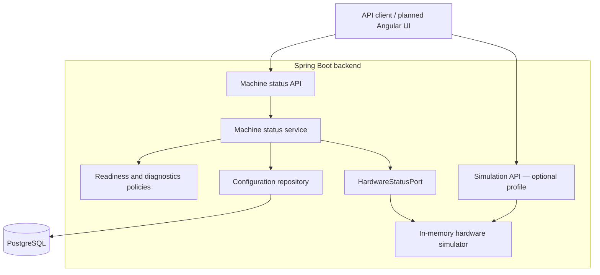
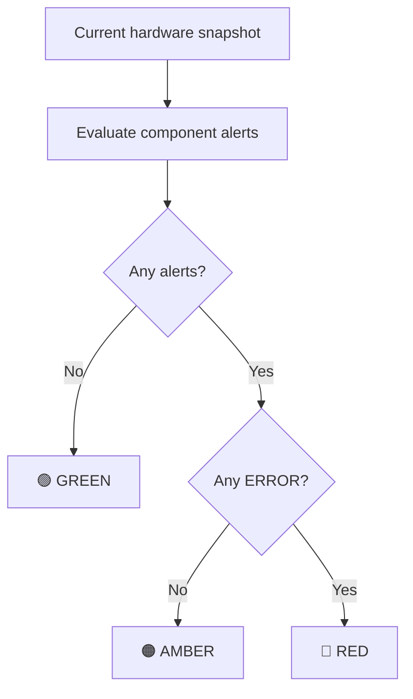

<div align="center">

# 🏧 Unit Cash Machine

### Cash deposit machine simulator

A Spring Boot backend that models hardware states, operational readiness  
and fault diagnostics for a cash deposit machine.


**Simulated hardware · Explicit domain rules · Testable fault scenarios**

[Overview](#-overview) ·
[Architecture](#-architecture) ·
[Quick start](#-quick-start) ·
[API demo](#-api-demo) ·
[Roadmap](#-roadmap)

</div>

---

## 🎯 Overview

A cash deposit machine needs to do more than count banknotes. It must know whether its door is secured, its cashbox is available and its hardware is operational—and explain what went wrong when it cannot proceed.

**Unit Cash Machine** is a local simulator inspired by observed workflows on a physical cash deposit machine. The current backend models six hardware components and exposes a consistent view of machine readiness and diagnostics.

The project is developed incrementally, starting with hardware simulation before introducing authentication, deposits, cash collection and reporting.

> **Current stage:** backend foundation, hardware simulation and diagnostics.
> No physical hardware is connected, and money processing is not implemented yet.

## ✨ Implemented capabilities

| Capability | What it provides |
| :--- | :--- |
| 🏧 Machine configuration | Persisted identity, location, currency and time zone |
| 🔌 Hardware simulation | Independent states for six hardware components |
| 🔒 Security status | Derived from door and lock states |
| ✅ Deposit readiness | Explicit rules for whether hardware can accept a new deposit |
| 🚦 Diagnostics | Structured alerts with severity, source and operational impact |
| 🧪 Fault injection | API for replacing the hardware snapshot during simulation |
| 🗄️ Database migrations | Versioned schema changes managed by Flyway |
| 🛠️ Quality tooling | Automated formatting checks, tests and coverage reports |

### Six components, one consistent snapshot

| Component | Modeled states |
| :--- | :--- |
| Banknote acceptor | `READY` · `ACCEPTING` · `JAMMED` · `OFFLINE` · `UNKNOWN` |
| Cashbox | `PRESENT` · `FULL` · `ABSENT` · `UNKNOWN` |
| Door | `CLOSED` · `OPEN` · `UNKNOWN` |
| Electronic lock | `LOCKED` · `UNLOCKED` · `FAULT` · `UNKNOWN` |
| Extension board | `ONLINE` · `OFFLINE` · `UNKNOWN` |
| Printer | `READY` · `OUT_OF_PAPER` · `OFFLINE` · `FAULT` · `UNKNOWN` |

## 🧠 Engineering decisions

- **Hardware behind an interface.** The application reads hardware through `HardwareStatusPort`, keeping status retrieval separate from the simulator implementation.
- **One snapshot per status request.** Readiness and diagnostics use the same immutable hardware snapshot.
- **Domain rules outside controllers.** Readiness and alert policies can be tested without starting Spring or connecting to a database.
- **Atomic state replacement.** The simulator replaces the complete snapshot without exposing a partially updated state.
- **Controlled simulation API.** State-changing endpoints require the `simulation` profile.
- **Versioned database schema.** Flyway applies migrations; Hibernate validates the resulting schema.
- **Behavior-focused tests.** Tests cover faults, recovery, invalid requests and endpoint availability.

## 🏗️ Architecture

The backend is organized by feature, with separate API, application, domain and infrastructure responsibilities where needed.



| Package | Responsibility |
| :--- | :--- |
| `machine` | Machine status, readiness rules and configuration persistence |
| `hardware.model` | Immutable snapshots and component state enums |
| `hardware.port` | Interface for reading hardware status |
| `hardware.simulator` | In-memory hardware implementation |
| `diagnostics` | Alert generation and indicator calculation |
| `simulation.api` | Validated simulation controls |

**Persistence boundary:** machine configuration is stored in PostgreSQL. Simulated hardware state lives in memory and resets to healthy defaults when the backend restarts. Alerts are calculated from the current snapshot; alert history is not yet persisted.

## 🚦 Readiness and diagnostics

The system answers three separate questions:

| Question | Rule |
| :--- | :--- |
| **Is the machine secure?** | Door is closed and lock is locked |
| **Is deposit hardware ready?** | Machine is secure, acceptor is ready, cashbox is present and extension board is online |
| **Is printing available?** | Printer is ready |

Indicator color summarizes the current alerts:



**Color and readiness serve different purposes.**

- An offline printer produces an amber warning and disables printing, while deposits remain available.
- An open door produces an amber warning and blocks deposits.
- A jammed acceptor produces a red error and blocks deposits.
- An acceptor in `ACCEPTING` is busy, not faulty: it produces no alert but is not ready for a new deposit.

## ⚙️ Technology stack

| Area | Technologies |
| :--- | :--- |
| Backend | Java 21, Spring Boot 4.1.2, Spring MVC |
| Validation | Jakarta Bean Validation, Problem Details responses |
| Persistence | Spring Data JPA, Hibernate, PostgreSQL 17 |
| Migrations | Flyway |
| Testing | JUnit, Mockito, Spring Boot Test, MockMvc |
| Formatting | Spotless, google-java-format with AOSP style |
| Coverage | JaCoCo |
| Build | Maven Wrapper |
| Local database | Docker Compose |
| Planned frontend | Angular |

## 🚀 Quick start

### 1. Prerequisites

- **JDK 21**
- **Docker Desktop with Compose** for the local database setup
- **Git**

Maven is supplied through the wrapper. Angular and Node.js are not required to run the current backend.

### 2. Start the database

From the repository root, create a local `.env` file containing:

```dotenv
DB_PASSWORD=replace-with-your-local-password
```

Start PostgreSQL using the repository's Compose configuration:

```powershell
docker compose up -d --wait
docker compose ps
```

The default backend connection expects:

| Setting | Value |
| :--- | :--- |
| Host | `localhost` |
| Port | `5434` |
| Database | `unit_cash_machine` |
| Username | `unit_app` |
| Schema | `cash_machine`, created by Flyway |

> A backend-only download requires the root Compose configuration or an independently configured PostgreSQL instance.

### 3. Configure the backend

In PowerShell:

```powershell
$env:DB_PASSWORD = 'replace-with-your-local-password'
Set-Location backend
```

Use the same password as the database role.

Docker Compose reads the root `.env` file; Spring Boot does not automatically load it. When running through IntelliJ IDEA, configure `DB_PASSWORD` in the application's Run Configuration.

<details>
<summary><strong>Optional database connection overrides</strong></summary>

```powershell
$env:DB_URL = 'jdbc:postgresql://localhost:5434/unit_cash_machine'
$env:DB_USERNAME = 'unit_app'
```

Use these variables when connecting to a different local database. The database role must have permission to apply the Flyway migrations.

</details>

### 4. Run with simulation controls

```powershell
.\mvnw.cmd spring-boot:run "-Dspring-boot.run.profiles=simulation"
```

The backend listens on **`http://127.0.0.1:8080`**.

To run without the state-changing simulation endpoint:

```powershell
.\mvnw.cmd spring-boot:run
```

Both modes use simulated hardware. The profile controls whether its state can be changed through the API.

### 5. Check application health

```powershell
Invoke-RestMethod 'http://localhost:8080/actuator/health'
```

## 🔌 API demo

| Method | Endpoint | Purpose |
| :--- | :--- | :--- |
| `GET` | `/actuator/health` | Application health |
| `GET` | `/api/machine/status` | Configuration, hardware, readiness and alerts |
| `PUT` | `/api/simulation/hardware` | Full hardware state replacement; requires `simulation` profile |

### Scenario: printer goes offline

Send a complete hardware snapshot:

```powershell
$hardwareState = @{
    acceptor       = 'READY'
    cashbox        = 'PRESENT'
    door           = 'CLOSED'
    lock           = 'LOCKED'
    extensionBoard = 'ONLINE'
    printer        = 'OFFLINE'
} | ConvertTo-Json

Invoke-RestMethod `
    -Uri 'http://localhost:8080/api/simulation/hardware' `
    -Method Put `
    -ContentType 'application/json' `
    -Body $hardwareState
```

Read the resulting machine status:

```powershell
Invoke-RestMethod 'http://localhost:8080/api/machine/status' |
    ConvertTo-Json -Depth 6
```

Relevant response fields:

```json
{
  "secure": true,
  "depositHardwareReady": true,
  "printingAvailable": false,
  "indicator": "AMBER",
  "alertCount": 1,
  "alerts": [
    {
      "code": "PRINTER_OFFLINE",
      "source": "PRINTER",
      "severity": "WARNING",
      "message": "Not operational",
      "blocksDeposit": false
    }
  ]
}
```

**Result:** the machine reports the printer problem without unnecessarily disabling deposits.

Repeat the request with `printer = 'READY'` to restore printing and clear the warning.

<details>
<summary><strong>Validation and simulation behavior</strong></summary>

- All six component fields are required.
- Missing fields, invalid enum values and malformed JSON are rejected.
- Invalid requests leave the hardware state unchanged.
- Repeating the same valid request preserves the same state.
- Without the `simulation` profile, the mutation endpoint is unavailable.
- Unusual combinations of component states are allowed for fault testing.

The simulation API models snapshots, not physical transitions or a complete cash collection workflow.

</details>

## 🧪 Tests and code quality

From `backend`, with PostgreSQL running and `DB_PASSWORD` configured:

```powershell
# Apply consistent Java formatting
.\mvnw.cmd spotless:apply

# Check formatting, run tests and generate coverage
.\mvnw.cmd clean verify

# Open the JaCoCo report
Start-Process .\target\site\jacoco\index.html
```

### What the tests exercise

| Area | Scenarios |
| :--- | :--- |
| Readiness | Secure defaults, unavailable components, busy acceptor and printer failures |
| Diagnostics | Component faults, severity priority, multiple alerts and recovery |
| Simulator | Snapshot replacement, previous snapshot stability and null rejection |
| Application service | Missing machine configuration |
| Status API | Stored configuration, initial hardware and computed status |
| Simulation API | State changes, recovery, repeated requests and invalid input |
| Profile boundaries | Simulation controller absent without its profile |

Integration tests currently use the configured PostgreSQL database and apply Flyway migrations. Use a local development or dedicated test database.

JaCoCo excludes only the application bootstrap class from its report. A coverage threshold is not yet enforced by the build.

## 🗺️ Roadmap

### Foundation — implemented

- [x] PostgreSQL configuration and Flyway migrations
- [x] Persisted machine identity and configuration
- [x] Hardware abstraction and in-memory simulator
- [x] Machine status and readiness rules
- [x] Simulation API with request validation
- [x] Component alerts and status indicators
- [x] Unit and integration tests
- [x] Formatting checks and coverage reporting

### User workflows — planned

- [ ] Angular machine interface and simulation controls
- [ ] User profiles, PIN authentication and role permissions
- [ ] EUR banknote acceptance and durable deposit records
- [ ] CIT cashbox replacement workflow
- [ ] Daily, per-user and device totals
- [ ] Simulated receipt printing and printer failure handling

### Reliability — planned

- [ ] Audit history
- [ ] Interrupted-operation recovery
- [ ] Isolated integration test databases
- [ ] Continuous integration

<details>
<summary><strong>Observed requirements guiding future workflows</strong></summary>

- Cashiers select a profile and authenticate with a PIN.
- CIT operators authenticate with a unique PIN without selecting a profile.
- The machine accepts one EUR banknote at a time.
- Accepted banknotes cannot be returned to the user.
- Logging out preserves the deposit without automatically printing a receipt.
- Daily totals start at midnight in `Europe/Belgrade`.
- Per-user daily reports require selecting a user.
- Confirmed cashbox replacement resets the device total while preserving daily totals.

These describe the intended behavior of future features, not completed functionality.

</details>

## 📌 Scope

This is an independent educational and portfolio project based on observed machine behavior.

It does not connect to real hardware, implement a vendor protocol or process real money. Authentication and authorization are planned; the current backend is configured for local use on the loopback interface.

## 📄 License

Distributed under the **MIT License**. See [LICENSE](LICENSE) for details.