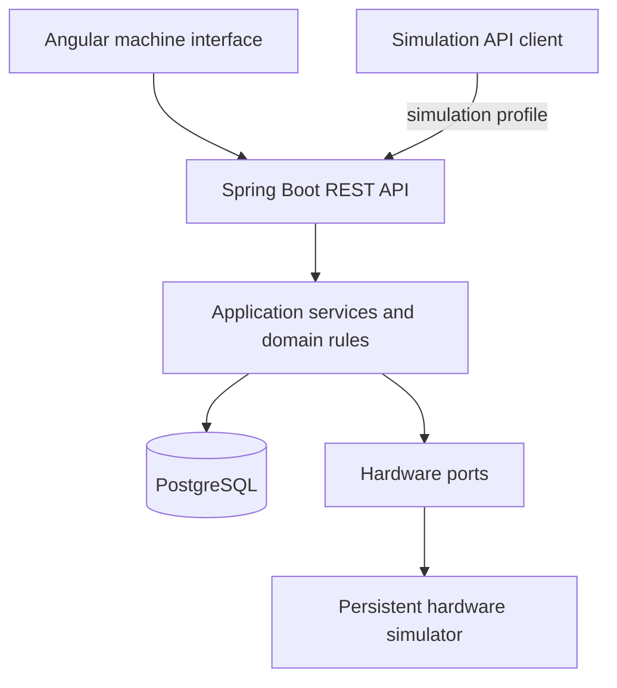
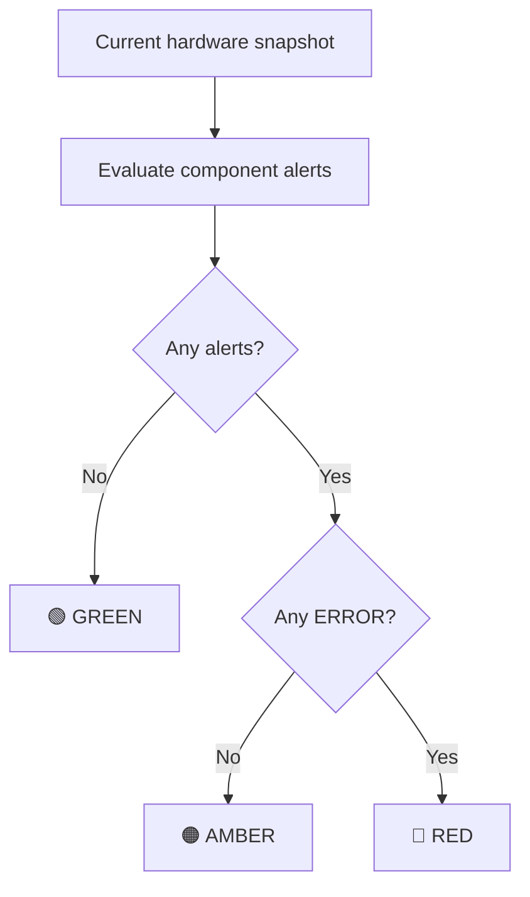

<div align="center">

# 🏧 Unit Cash Machine

### Cash deposit machine simulator

A cash deposit machine simulator built with Spring Boot and Angular, inspired by workflows observed on a physical machine. It combines a touchscreen interface, EUR deposits, guided cash collection and persistent hardware simulation.


**Real-world workflows · Transactional cash records · Testable failure scenarios**

[Overview](#-overview) ·
[Architecture](#architecture) ·
[Quick start](#-quick-start) ·
[API demo](#-api-demo) ·
[Roadmap](#roadmap)

</div>

---

## 🎯 Overview

A cash deposit machine must keep its cash records consistent while users insert banknotes, operators collect money and hardware changes state.

**Unit Cash Machine** models these workflows locally: cashiers deposit EUR banknotes, CIT operators complete a guided collection procedure, and diagnostics explain when the machine cannot accept deposits.

Authentication, deposits and cash collection are implemented. Reports, virtual printing, maintenance commands and extended recovery testing are next.

## ✨ Features

| Area | Description | Status |
| :--- | :--- | :--- |
| 🔌 Hardware simulation | Persistent component states, fault injection and simulated physical actions | Available |
| 🖥️ Machine interface | Touchscreen-inspired navigation, machine information and live diagnostics | Available |
| 🚦 Diagnostics | Component alerts, severity indicators and connection-loss feedback | Available |
| 🔐 Authentication | Profile selection, PIN login and role-based access | Available |
| 💶 Deposits | Immediate banknote persistence, server-calculated totals and safe request retries | Available |
| 🚚 Cash collection | Guided CIT workflow, door and lock monitoring, and cash-cycle rollover | Available |
| 🧾 Reporting | Device, daily and per-user reports with virtual printing | Planned |
| 🛠️ Maintenance | Diagnostics commands and simulated device lifecycle operations | Planned |


## 🧠 Engineering decisions

- **Hardware ports.** Application services depend on hardware interfaces, separating workflow rules from the simulator implementation.
- **Transactional machine access.** Deposits, collection and hardware changes share a database row lock. Database constraints additionally enforce active-operation rules.
- **Immediate cash records.** Accepted banknotes are persisted before the request completes; logout only closes the deposit.
- **Idempotent operations.** Banknote identifiers prevent duplicate counting, while repeated CIT confirmations preserve the recorded result.
- **Persistent collection workflow.** CIT progress and events survive application restarts. Manual cassette confirmations remain separate from sensor readings, matching the observed machine.
- **Separate cash cycles and daily history.** Successful collection closes the current cash cycle once, resetting the device total while preserving deposit history for daily reporting.
- **Explicit recovery behavior.** The frontend retries uncertain banknote requests with the original identifier. Delayed door locking completes CIT automatically; other interruptions require recovery according to their cause.

<a id="architecture"></a>
## 🏗️ Architecture

The Spring Boot backend is organized by feature, with separate API,
application, domain and infrastructure responsibilities where needed.
The Angular frontend provides the machine interface.



PostgreSQL stores machine configuration, user accounts, hardware state, deposits, cash cycles and collection events. Flyway manages the schema, and Hibernate validates JPA mappings.

User accounts and configuration use Spring Data JPA. Cash workflows and hardware state use Spring JDBC with explicit SQL and transactional locking.

HTTP sessions are not restored after a backend restart. Cash records and CIT progress remain available, and interrupted operations are reconciled before normal processing resumes.

## 🚦 Readiness and diagnostics

<details>
<summary><strong>🔎 Hardware states and readiness rules</strong></summary>

| Question | Rule |
| :--- | :--- |
| **Is the machine secure?** | Door is closed and lock is locked |
| **Is deposit hardware ready?** | Machine is secure, acceptor is ready, cashbox is present and extension board is online |
| **Is printing available?** | Printer is ready |

### Six components, one consistent snapshot

| Component | Modeled states |
| :--- | :--- |
| Banknote acceptor | `READY` · `ACCEPTING` · `JAMMED` · `OFFLINE` · `UNKNOWN` |
| Cashbox | `PRESENT` · `FULL` · `ABSENT` · `UNKNOWN` |
| Door | `CLOSED` · `OPEN` · `UNKNOWN` |
| Electronic lock | `LOCKED` · `UNLOCKED` · `FAULT` · `UNKNOWN` |
| Extension board | `ONLINE` · `OFFLINE` · `UNKNOWN` |
| Printer | `READY` · `OUT_OF_PAPER` · `OFFLINE` · `FAULT` · `UNKNOWN` |

</details>

Indicator color summarizes the current alerts:



**Color and readiness serve different purposes.**

- An offline printer produces an amber warning and disables printing, while deposits remain available.
- An open door produces an amber warning and blocks deposits.
- A jammed acceptor produces a red error and blocks deposits.
- An acceptor in `ACCEPTING` is busy, not faulty: it produces no alert but is not ready for a new deposit.
- An unfinished CIT procedure blocks deposits. A delayed lock produces a warning and completes automatically once the door is closed and locked; interruptions requiring recovery produce an error.

## ⚙️ Technology stack

| Area | Technologies |
| :--- | :--- |
| Backend | Java 21, Spring Boot 4.1.2, Spring MVC |
| Frontend | Angular 21, TypeScript, SCSS, standalone components |
| Validation | Jakarta Bean Validation, Problem Details responses |
| Persistence | Spring Data JPA, Hibernate, Spring JDBC (`JdbcTemplate`), PostgreSQL 17 |
| Migrations | Flyway |
| Security | Spring Security, BCrypt PIN hashing, server-side sessions, CSRF protection |
| Testing | JUnit, Mockito, Spring Boot Test, MockMvc |
| Frontend testing | Vitest, Angular TestBed |
| Formatting | Spotless, google-java-format with AOSP style, Prettier |
| Coverage | JaCoCo |
| Build | Maven Wrapper, Angular CLI |
| Local database | Docker Compose |

## 🚀 Quick start

### 1. Prerequisites

- **JDK 21**
- **Node.js 22.19.0**
- **npm 11.6.2**
- **Docker Desktop with Compose** for the local database setup
- **Git**

Maven is supplied through the wrapper, and Angular CLI is installed with the frontend dependencies. Node.js is only required for the frontend.

### 2. Start the database

From the repository root, create a local `.env` file containing:

```dotenv
DB_PASSWORD=replace-with-your-local-password
```

Start PostgreSQL using the repository's Compose configuration:

```powershell
docker compose up -d --wait
docker compose ps
```

The default backend connection expects:

| Setting | Value |
| :--- | :--- |
| Host | `localhost` |
| Port | `5434` |
| Database | `unit_cash_machine` |
| Username | `unit_app` |
| Schema | `cash_machine`, created by Flyway |

### 3. Configure the backend

In PowerShell:

```powershell
$env:DB_PASSWORD = 'replace-with-your-local-password'
Set-Location backend
```

Use the same password as the database role.

Docker Compose reads the root `.env` file; Spring Boot does not automatically load it. When running through IntelliJ IDEA, configure `DB_PASSWORD` in the application's Run Configuration.

<details>
<summary><strong>Optional database connection overrides</strong></summary>

```powershell
$env:DB_URL = 'jdbc:postgresql://localhost:5434/unit_cash_machine'
$env:DB_USERNAME = 'unit_app'
```

Use these variables when connecting to a different local database. The database role must have permission to apply the Flyway migrations.

</details>

### 4. Run with simulation controls

```powershell
.\mvnw.cmd spring-boot:run "-Dspring-boot.run.profiles=simulation,demo"
```

The `simulation` profile enables hardware fault injection, banknote insertion and CIT physical-action controls. The `demo` profile creates missing demo accounts for local testing.

| Role | Account | PIN |
| :--- | :--- | :--- |
| Cashier | Demo Cashier | `1111` |
| Management | Demo Manager | `2222` |
| Maintenance | Demo Maintenance | `3333` |
| CIT | PIN-only login | `4444` |

Demo accounts remain in the database after the `demo` profile is disabled.
Existing accounts are not overwritten.

Sessions expire 15 minutes after login. Refreshing the page preserves a valid session.

The backend listens on **`http://127.0.0.1:8080`**.

To run without simulation endpoints:

```powershell
.\mvnw.cmd spring-boot:run
```

Both modes use simulated hardware. CIT authentication still performs the workflow's electronic unlock; the `simulation` profile enables API controls for physical actions and fault injection.

### 5. Check application health

```powershell
Invoke-RestMethod 'http://localhost:8080/actuator/health'
```

### 6. Run the frontend

Keep the backend running. Open another terminal in the repository root:

```powershell
cd frontend
npx --yes npm@11.6.2 ci
npm start
```

Open **http://127.0.0.1:4200**.

The Angular development server proxies `/api/**` requests to
`http://127.0.0.1:8080`. No database credentials are stored in the frontend.

## 🔌 API demo

| Method | Endpoint | Purpose |
| :--- | :--- | :--- |
| `GET` | `/actuator/health` | Application health |
| `GET` | `/api/machine/status` | Configuration, hardware, readiness and alerts |
| `GET` | `/api/users?role=CASHIER` | Active profiles for the selected role; CIT profiles are not listed |
| `GET` | `/api/auth/csrf` | CSRF token for the current session |
| `POST` | `/api/auth/login` | Profile and PIN authentication |
| `POST` | `/api/auth/cit-login` | PIN-only CIT authentication |
| `GET` | `/api/auth/me` | Current authenticated user |
| `PUT` | `/api/simulation/hardware` | Replace hardware state; requires `simulation`, `MAINTENANCE` access and CSRF |
| `POST` | `/api/auth/logout` | Complete the cashier deposit, if applicable, and end the current session |
| `GET` | `/api/deposits/current` | Current deposit and acceptance availability; requires `CASHIER` access |
| `POST` | `/api/deposits/current/banknotes` | Simulate one banknote; requires `simulation`, `CASHIER` access and CSRF |
| `GET` | `/api/collections/current` | Current CIT procedure and door/lock status |
| `POST` | `/api/collections/{id}/confirm-removal` | Confirm cassette removal manually |
| `POST` | `/api/collections/{id}/confirm-insertion` | Confirm cassette insertion manually |
| `POST` | `/api/collections/{id}/restart` | Release the incomplete procedure for reauthentication and end the session |
| `POST` | `/api/collections/{id}/simulate` | Simulate a physical action; requires the `simulation` profile |

Collection endpoints require CIT access. State-changing requests require a valid CSRF token. Logout is rejected while the operator has an unfinished collection.

### Banknote request

After cashier login, obtain a fresh CSRF token and send the request using
the authenticated session:

```http
POST /api/deposits/current/banknotes
Content-Type: application/json
X-CSRF-TOKEN: <token>
```

```json
{
  "operationId": "f4833abb-9de5-48e6-b956-b906139a635b",
  "currency": "EUR",
  "denomination": 20
}
```

Use a new `operationId` for each new banknote. Retry an uncertain operation
with its original identifier and unchanged contents.

Possible outcomes are `ACCEPTED`, `CURRENCY_REJECTED` and
`DENOMINATION_REJECTED`. The response includes the current deposit;
`totalCents` is expressed in cents.

<details>
<summary><strong>🧪 Try a fault scenario: printer offline</strong></summary>

Send a complete hardware snapshot:

```powershell
$baseUrl = 'http://127.0.0.1:8080'

$csrf = Invoke-RestMethod `
    -Uri "$baseUrl/api/auth/csrf" `
    -SessionVariable unitSession

$loginBody = @{
    userId = '00000000-0000-0000-0000-000000000003'
    role   = 'MAINTENANCE'
    pin    = '3333'
} | ConvertTo-Json

Invoke-RestMethod `
    -Uri "$baseUrl/api/auth/login" `
    -Method Post `
    -WebSession $unitSession `
    -Headers @{ $csrf.headerName = $csrf.token } `
    -ContentType 'application/json' `
    -Body $loginBody

# Login invalidates the previous CSRF token.
$csrf = Invoke-RestMethod `
    -Uri "$baseUrl/api/auth/csrf" `
    -WebSession $unitSession

$hardwareState = @{
    acceptor       = 'READY'
    cashbox        = 'PRESENT'
    door           = 'CLOSED'
    lock           = 'LOCKED'
    extensionBoard = 'ONLINE'
    printer        = 'OFFLINE'
} | ConvertTo-Json

Invoke-RestMethod `
    -Uri "$baseUrl/api/simulation/hardware" `
    -Method Put `
    -WebSession $unitSession `
    -Headers @{ $csrf.headerName = $csrf.token } `
    -ContentType 'application/json' `
    -Body $hardwareState
```

Read the resulting machine status:

```powershell
Invoke-RestMethod "$baseUrl/api/machine/status" |
    ConvertTo-Json -Depth 6
```

Relevant response fields:

```json
{
  "secure": true,
  "depositHardwareReady": true,
  "printingAvailable": false,
  "indicator": "AMBER",
  "alertCount": 1,
  "alerts": [
    {
      "code": "PRINTER_OFFLINE",
      "source": "PRINTER",
      "severity": "WARNING",
      "message": "Not operational",
      "blocksDeposit": false
    }
  ]
}
```

**Result:** the machine reports the printer problem without unnecessarily disabling deposits.

Repeat the request with `printer = 'READY'` to restore printing and clear the warning.

- All six component fields are required.
- Missing fields, invalid enum values and malformed JSON are rejected.
- Invalid requests leave the hardware state unchanged.
- Repeating the same valid request preserves the same state.
- Without the `simulation` profile, the mutation endpoint is unavailable.
- Unusual combinations of component states are allowed for fault testing.

The maintenance simulation endpoint replaces complete hardware snapshots for fault testing. CIT simulation controls model individual physical actions within the collection workflow.

</details>

## 🧪 Tests and code quality

From `backend`, with PostgreSQL running and `DB_PASSWORD` configured:

```powershell
# Apply consistent Java formatting
.\mvnw.cmd spotless:apply

# Check formatting, run tests and generate coverage
.\mvnw.cmd clean verify

# Open the JaCoCo report
Start-Process .\target\site\jacoco\index.html
```

From `frontend`:

```powershell
npm run format:check
npm run build
npm test -- --watch=false
```

To apply formatting:

```powershell
npm run format
```

### What the tests exercise

Backend tests cover readiness and diagnostics, authentication and session validity, deposit ownership, banknote validation, duplicate requests and stale-deposit reconciliation.

CIT tests cover workflow transitions, manual confirmations, access restrictions, lock timeouts, delayed-lock completion, cash-cycle rollover and selected hardware and restart scenarios.

Frontend tests cover authentication, connection feedback, uncertain banknote requests, stale-response protection and CIT interaction and session handling.

Extended testing of concurrent transactions, database failures and process termination remains planned.

JaCoCo generates backend coverage reports and excludes only the application bootstrap class. The build does not currently enforce a coverage threshold.

<a id="roadmap"></a>
## 🗺️ Roadmap

- [x] Configure PostgreSQL, Flyway and application persistence
- [x] Implement hardware simulation, readiness rules and diagnostics
- [x] Build the Angular machine interface and live status feedback
- [x] Implement PIN authentication, role-based access and server-side sessions
- [x] Implement EUR deposits, banknote simulation and duplicate-request protection
- [x] Implement CIT collection, persistent workflow state and cash-cycle rollover
- [ ] Implement device and daily reports with virtual printing
- [ ] Implement maintenance commands and device lifecycle simulation
- [ ] Add maintenance UI controls for hardware fault injection
- [ ] Test concurrent requests, database failures and process interruption
- [ ] Introduce dedicated integration test databases and continuous integration

<details>
<summary><strong>Observed workflow requirements</strong></summary>

- Cashiers select a profile and authenticate with a PIN.
- CIT operators authenticate with a unique PIN without selecting a profile.
- The machine accepts one EUR banknote at a time.
- Accepted banknotes cannot be returned to the user.
- Logging out preserves the deposit without automatically printing a receipt.
- Daily totals start at midnight in `Europe/Belgrade`.
- Per-user daily reports require selecting a user.
- Successful CIT completion resets the device total while preserving daily history.
- Cassette replacement uses manual confirmations; delayed locking completes CIT without requiring a restart.

Authentication and deposit rules are implemented. Reporting and cashbox
replacement requirements guide the upcoming workflows.

</details>

## 📌 Scope

This is an independent educational and portfolio project based on observed machine behavior.

Authentication, deposit and CIT workflows are implemented. Reporting requirements guide the next development phase.

## 📄 License

Distributed under the **MIT License**. See [LICENSE](LICENSE) for details.