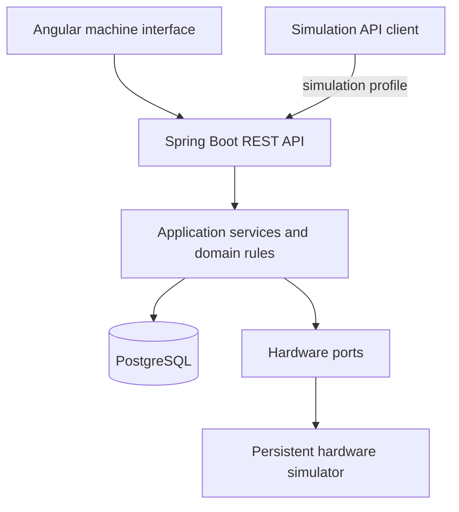

<div align="center">

# 🏧 Unit Cash Machine

### Cash deposit machine simulator

A local cash deposit machine simulator built with Spring Boot and Angular, based on workflows observed on a physical machine. It combines a touchscreen interface with transactional cash records, guided cash collection, reporting and simulated hardware maintenance.


**Real-world workflows · Transactional cash records · Testable failure scenarios**

[Overview](#-overview) ·
[Architecture](#architecture) ·
[Quick start](#-quick-start) ·
[API demo](#-api-demo) ·
[Roadmap](#roadmap)

</div>

---

## 🎯 Overview

A cash deposit machine must keep its cash records consistent while users insert banknotes, operators collect money and hardware changes state.

**Unit Cash Machine** models these workflows locally: cashiers deposit EUR banknotes, CIT operators complete a guided collection procedure, and diagnostics explain when the machine cannot accept deposits.

Implemented workflows include PIN authentication, EUR deposits, CIT collection, management reports, PDF receipts and virtual printing. Role-based maintenance adds component inspection and simulated Reset, Reboot, Shut Down and Exit Application operations.

## ✨ Features

| Area | Description |
| :--- | :--- |
| 🖥️ Machine interface | Touchscreen-inspired navigation, role-specific menus and live status feedback |
| 🔐 Authentication | PIN login, role-based access, CSRF protection and inactivity-based session expiration |
| 💶 Deposits | Immediate banknote persistence, server-calculated totals and duplicate-request protection |
| 🚚 Cash collection | Persistent CIT workflow, door and lock monitoring, and cash-cycle rollover |
| 🧾 Reports and receipts | Device and daily totals, denomination breakdowns, cashier summaries and downloadable PDF receipts |
| 🚦 Diagnostics | Component alerts, severity indicators and connection-loss feedback |
| 🔌 Hardware simulation | Persistent component states, fault injection and simulated physical actions |
| 🛠️ Maintenance | Component details, driver reset tracking and simulated machine lifecycle commands |


## 🧠 Engineering decisions

- **Hardware ports.** Application services depend on hardware interfaces, separating workflow rules from the simulator implementation.
- **Transactional machine access.** Deposits, collection, hardware changes and maintenance commands share a database row lock. Active deposits and unfinished CIT procedures prevent maintenance operations.
- **Immediate cash records.** Accepted banknotes are persisted before the request completes. Finishing a non-empty deposit creates a saved receipt, even when the printer is unavailable.
- **Idempotent operations.** Banknote, print and maintenance request identifiers prevent duplicate execution. Uncertain requests are retried with their original identifiers.
- **Persistent collection workflow.** CIT progress and events survive application restarts. Manual cassette confirmations remain separate from sensor readings, matching the observed machine.
- **Consistent reporting.** Reports use the same machine lock as deposits and collection. Device totals follow cash cycles; daily totals follow banknote acceptance times in the machine's time zone.
- **Receipts separate from print attempts.** Saved receipt content remains unchanged. Failed prints can be retried without changing cash records, and cashiers can download their receipt after logout through a short-lived access token.
- **Persistent machine lifecycle.** Runtime state and maintenance commands survive page reloads and backend restarts. Reboot, shutdown and application exit invalidate existing sessions; driver reset preserves the session and physical hardware state.

<a id="architecture"></a>
## 🏗️ Architecture

The Spring Boot backend is organized by feature, with separate API,
application, domain and infrastructure responsibilities where needed.
The Angular frontend provides the machine interface.



PostgreSQL stores configuration, accounts, hardware and runtime state, cash records, collection events, receipts, print attempts and maintenance commands. Flyway manages the schema, and Hibernate validates JPA mappings.

User accounts and configuration use Spring Data JPA. Cash workflows and hardware state use Spring JDBC with explicit SQL and transactional locking.

HTTP sessions are not restored after a backend restart. Cash records, CIT progress and machine runtime state remain persisted. Interrupted cash workflows are reconciled before normal processing resumes, while pending maintenance transitions are completed by the maintenance monitor.

## 🚦 Readiness and diagnostics

<details>
<summary><strong>🔎 Hardware states and readiness rules</strong></summary>

| Question | Rule |
| :--- | :--- |
| **Is the machine physically secure?** | Door is closed and lock is locked |
| **Is deposit hardware ready?** | Application is running, machine is secure, acceptor is ready, cashbox is present and extension board is online |
| **Is printing available?** | Application is running and printer is ready |

### Six components, one consistent snapshot

| Component | Modeled states |
| :--- | :--- |
| Banknote acceptor | `READY` · `ACCEPTING` · `JAMMED` · `OFFLINE` · `UNKNOWN` |
| Cashbox | `PRESENT` · `FULL` · `ABSENT` · `UNKNOWN` |
| Door | `CLOSED` · `OPEN` · `UNKNOWN` |
| Electronic lock | `LOCKED` · `UNLOCKED` · `FAULT` · `UNKNOWN` |
| Extension board | `ONLINE` · `OFFLINE` · `UNKNOWN` |
| Printer | `READY` · `OUT_OF_PAPER` · `OFFLINE` · `FAULT` · `UNKNOWN` |

</details>

Indicator color summarizes the current alerts:

The indicator is green when there are no alerts, amber when only warnings are present, and red when any error is present. Diagnostics combine hardware conditions, CIT progress and application runtime state.

**Color and readiness serve different purposes.**

- An offline printer produces an amber warning. Deposits remain available, and receipts are saved for later printing.
- An open door produces an amber warning and blocks deposits.
- A jammed acceptor produces a red error and blocks deposits.
- An acceptor in `ACCEPTING` is busy, not faulty: it produces no alert but is not ready for a new deposit.
- An unfinished CIT procedure blocks deposits. A delayed lock produces a warning and completes automatically once the door is closed and locked; interruptions requiring recovery produce an error.
- Reset temporarily blocks new operations while preserving the operator session. Physical faults remain visible after the reset.

## ⚙️ Technology stack

| Area | Technologies |
| :--- | :--- |
| Backend | Java 21, Spring Boot 4.1.2, Spring MVC |
| Frontend | Angular 21, TypeScript, SCSS, standalone components |
| Validation | Jakarta Bean Validation, Problem Details responses |
| Persistence | Spring Data JPA, Hibernate, Spring JDBC (`JdbcTemplate`), PostgreSQL 17 |
| Migrations | Flyway |
| Security | Spring Security, BCrypt PIN hashing, server-side sessions, CSRF protection |
| Testing | JUnit, Mockito, Spring Boot Test, MockMvc |
| Frontend testing | Vitest, Angular TestBed |
| Formatting | Spotless, google-java-format with AOSP style, Prettier |
| PDF generation | Apache PDFBox |
| Coverage | JaCoCo |
| Build | Maven Wrapper, Angular CLI |
| Local database | Docker Compose |

## 🚀 Quick start

### 1. Prerequisites

- **JDK 21**
- **Node.js 22.19.0**
- **npm 11.6.2**
- **Docker Desktop with Compose** for the local database setup
- **Git**

Maven is supplied through the wrapper, and Angular CLI is installed with the frontend dependencies. Node.js is only required for the frontend.

### 2. Start the database

From the repository root, create a local `.env` file containing:

```dotenv
DB_PASSWORD=replace-with-your-local-password
```

Start PostgreSQL using the repository's Compose configuration:

```powershell
docker compose up -d --wait
docker compose ps
```

The default backend connection expects:

| Setting | Value |
| :--- | :--- |
| Host | `localhost` |
| Port | `5434` |
| Database | `unit_cash_machine` |
| Username | `unit_app` |
| Schema | `cash_machine`, created by Flyway |

### 3. Configure the backend

In PowerShell:

```powershell
$env:DB_PASSWORD = 'replace-with-your-local-password'
Set-Location backend
```

Use the same password as the database role.

Docker Compose reads the root `.env` file; Spring Boot does not automatically load it. When running through IntelliJ IDEA, configure `DB_PASSWORD` in the application's Run Configuration.

<details>
<summary><strong>Optional database connection overrides</strong></summary>

```powershell
$env:DB_URL = 'jdbc:postgresql://localhost:5434/unit_cash_machine'
$env:DB_USERNAME = 'unit_app'
```

Use these variables when connecting to a different local database. The database role must have permission to apply the Flyway migrations.

</details>

### 4. Run with simulation controls

```powershell
.\mvnw.cmd spring-boot:run "-Dspring-boot.run.profiles=simulation,demo"
```

The `simulation` profile enables hardware fault injection, banknote insertion, CIT physical-action controls and simulator power-on/application-start endpoints. The `demo` profile creates missing demo accounts for local testing.

| Role | Account | PIN |
| :--- | :--- | :--- |
| Cashier | Demo Cashier | `1111` |
| Management | Demo Manager | `2222` |
| Maintenance | Demo Maintenance | `3333` |
| CIT | PIN-only login | `4444` |

Demo accounts remain in the database after the `demo` profile is disabled.
Existing accounts are not overwritten.

Sessions have a 15-minute absolute limit. Cashiers are signed out after 60 seconds of inactivity; management and maintenance after 30 seconds. Screen interaction extends the inactivity deadline; background polling does not. CIT has no additional short inactivity timeout.

Management accounts can access inventory, saved receipts, Reset and Reboot. Maintenance accounts additionally expose component inspection, Shut Down and Exit Application. These lifecycle operations affect only the simulated machine; they do not stop the backend process or operating system.

The backend listens on **`http://127.0.0.1:8080`**.

To run without simulation endpoints:

```powershell
.\mvnw.cmd spring-boot:run
```

Both modes use simulated hardware. CIT authentication still performs the workflow's electronic unlock; the `simulation` profile enables API controls for physical actions and fault injection.

### 5. Check application health

```powershell
Invoke-RestMethod 'http://localhost:8080/actuator/health'
```

### 6. Run the frontend

Keep the backend running. Open another terminal in the repository root:

```powershell
cd frontend
npx --yes npm@11.6.2 ci
npm start
```

Open **http://127.0.0.1:4200**.

The Angular development server proxies `/api/**` requests to
`http://127.0.0.1:8080`. No database credentials are stored in the frontend.

## 🔌 API demo

| Area | Main endpoints |
| :--- | :--- |
| Health and status | `GET /actuator/health`, `GET /api/machine/status` |
| Authentication | `/api/auth/login`, `/cit-login`, `/me`, `/csrf`, `/activity`, `/logout` |
| User selection | `GET /api/users?role=CASHIER` |
| Deposits | `GET /api/deposits/current`, `POST /api/deposits/current/banknotes` |
| CIT collection | `/api/collections/current`, `/{id}/confirm-removal`, `/{id}/confirm-insertion`, `/{id}/restart`, `/{id}/simulate` |
| Reports | `GET /api/reports`, `GET /api/reports/{type}`, `POST /api/reports/{type}/print` |
| Saved receipts | `GET /api/receipts`, `GET /api/receipts/{id}/pdf`, `POST /api/receipts/{id}/print` |
| Cashier receipt access | `POST /api/deposits/current/receipt-access`, `GET /api/receipt-access/pdf` |
| Hardware simulation | `PUT /api/simulation/hardware` |
| Runtime | `GET /api/machine/runtime` |
| Maintenance | `POST /api/maintenance/commands`, `GET /api/maintenance/commands/{id}`, `GET /api/maintenance/components` |
| Simulator lifecycle | `POST /api/simulator/power-on`, `POST /api/simulator/start-application` |

Reports and saved receipt management require MANAGEMENT access; collection requires CIT access. System commands require MANAGEMENT or MAINTENANCE, with shutdown, application exit and component inspection restricted to MAINTENANCE. Cashier receipt downloads use a short-lived `X-Receipt-Token`. State-changing requests require CSRF protection. Simulator lifecycle endpoints represent external simulator controls and are available only with the `simulation` profile.

### Banknote request

After cashier login, obtain a fresh CSRF token and send the request using
the authenticated session:

```http
POST /api/deposits/current/banknotes
Content-Type: application/json
X-CSRF-TOKEN: <token>
```

```json
{
  "operationId": "f4833abb-9de5-48e6-b956-b906139a635b",
  "currency": "EUR",
  "denomination": 20
}
```

Use a new `operationId` for each new banknote. Retry an uncertain operation
with its original identifier and unchanged contents.

Possible outcomes are `ACCEPTED`, `CURRENCY_REJECTED` and
`DENOMINATION_REJECTED`. The response includes the current deposit;
`totalCents` is expressed in cents.

<details>
<summary><strong>🧪 Try a fault scenario: printer offline</strong></summary>

Send a complete hardware snapshot:

```powershell
$baseUrl = 'http://127.0.0.1:8080'

$csrf = Invoke-RestMethod `
    -Uri "$baseUrl/api/auth/csrf" `
    -SessionVariable unitSession

$loginBody = @{
    userId = '00000000-0000-0000-0000-000000000003'
    role   = 'MAINTENANCE'
    pin    = '3333'
} | ConvertTo-Json

Invoke-RestMethod `
    -Uri "$baseUrl/api/auth/login" `
    -Method Post `
    -WebSession $unitSession `
    -Headers @{ $csrf.headerName = $csrf.token } `
    -ContentType 'application/json' `
    -Body $loginBody

# Login invalidates the previous CSRF token.
$csrf = Invoke-RestMethod `
    -Uri "$baseUrl/api/auth/csrf" `
    -WebSession $unitSession

$hardwareState = @{
    acceptor       = 'READY'
    cashbox        = 'PRESENT'
    door           = 'CLOSED'
    lock           = 'LOCKED'
    extensionBoard = 'ONLINE'
    printer        = 'OFFLINE'
} | ConvertTo-Json

Invoke-RestMethod `
    -Uri "$baseUrl/api/simulation/hardware" `
    -Method Put `
    -WebSession $unitSession `
    -Headers @{ $csrf.headerName = $csrf.token } `
    -ContentType 'application/json' `
    -Body $hardwareState
```

Read the resulting machine status:

```powershell
Invoke-RestMethod "$baseUrl/api/machine/status" |
    ConvertTo-Json -Depth 6
```

With no unfinished CIT procedure or other active faults, the relevant response fields are:

```json
{
  "secure": true,
  "depositHardwareReady": true,
  "printingAvailable": false,
  "indicator": "AMBER",
  "alertCount": 1,
  "alerts": [
    {
      "code": "PRINTER_OFFLINE",
      "source": "PRINTER",
      "severity": "WARNING",
      "message": "Not operational",
      "blocksDeposit": false
    }
  ]
}
```

**Result:** the machine reports the printer problem without unnecessarily disabling deposits.

Repeat the request with `printer = 'READY'` to restore printing and clear the warning.

- All six component fields are required.
- Missing fields, invalid enum values and malformed JSON are rejected.
- Invalid requests leave the hardware state unchanged.
- Repeating the same valid request preserves the same state.
- Without the `simulation` profile, the mutation endpoint is unavailable.
- Unusual combinations of component states are allowed for fault testing.

The maintenance simulation endpoint replaces complete hardware snapshots for fault testing. CIT simulation controls model individual physical actions within the collection workflow.

</details>

## 🧪 Tests and code quality

From `backend`, with PostgreSQL running and `DB_PASSWORD` configured:

```powershell
# Apply consistent Java formatting
.\mvnw.cmd spotless:apply

# Check formatting, run tests and generate coverage
.\mvnw.cmd clean verify

# Open the JaCoCo report
Start-Process .\target\site\jacoco\index.html
```

From `frontend`:

```powershell
npm run format:check
npm run build
npm test -- --watch=false
```

To apply formatting:

```powershell
npm run format
```

### What the tests exercise

Backend tests cover authentication and session expiration, hardware readiness, deposit validation and ownership, idempotent operations, CIT transitions and cash-cycle rollover. Reporting tests include daily boundaries and daylight-saving changes, saved receipts, print retries, access restrictions and PDF rendering.

Maintenance tests cover permissions, active-work restrictions, command replay, runtime transitions, session invalidation, component reset tracking and request filtering while the application is unavailable. Frontend tests exercise authentication, connection feedback, cash workflows and maintenance runtime handling.

Manual checks cover the main machine workflows, role-specific screens, physical fault scenarios and simulated lifecycle operations. Broader concurrency, database-outage and abrupt process-termination testing remain future work.

JaCoCo generates backend coverage reports, excluding the application bootstrap class. The build does not currently enforce a coverage threshold.

<a id="roadmap"></a>
## 🗺️ Roadmap

- [x] Configure PostgreSQL, Flyway and application persistence
- [x] Implement hardware simulation, readiness rules and diagnostics
- [x] Build the Angular machine interface and live status feedback
- [x] Implement PIN authentication, role-based access and session expiration
- [x] Implement EUR deposits and duplicate-request protection
- [x] Implement persistent CIT collection and cash-cycle rollover
- [x] Implement device and daily reports with virtual printing
- [x] Implement role-based maintenance, component inspection and lifecycle simulation
- [ ] Add maintenance UI controls for hardware fault injection
- [ ] Model failed or partially completed driver resets
- [ ] Extend concurrency, database-outage and process-interruption tests
- [ ] Introduce isolated integration test databases, browser E2E tests and CI

<details>
<summary><strong>Observed workflow requirements</strong></summary>

- Cashiers select a profile and authenticate with a PIN.
- CIT operators authenticate with a unique PIN without selecting a profile.
- The machine accepts one EUR banknote at a time.
- Accepted banknotes cannot be returned to the user.
- Manual logout or inactivity expiration prints a receipt only when money was accepted.
- Daily totals start at midnight in `Europe/Belgrade`.
- Daily user reports group deposited amounts by cashier without a separate user selection.
- Successful CIT completion resets the device total while preserving daily history.
- Cassette replacement uses manual confirmations; delayed locking completes CIT without requiring a restart.

</details>

## 📌 Scope

An independent educational and portfolio project modeling the software of a single local cash deposit machine. Hardware, printing and operating-system lifecycle actions are simulated; the application does not process real money or implement a vendor protocol.

Back-office connectivity is outside the current implementation. Cash records are persisted locally; synchronization with a central system would require a defined integration contract, delivery acknowledgements and duplicate-safe retries.

## 📄 License

Distributed under the **MIT License**. See [LICENSE](LICENSE) for details.